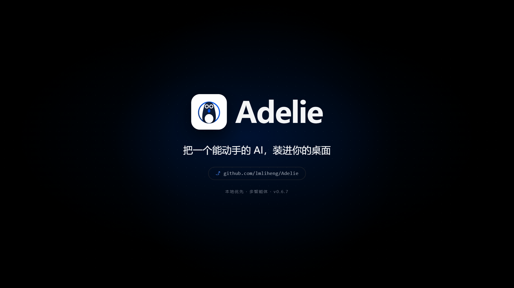
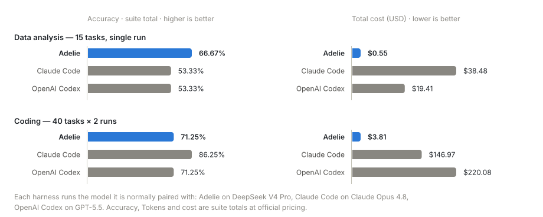
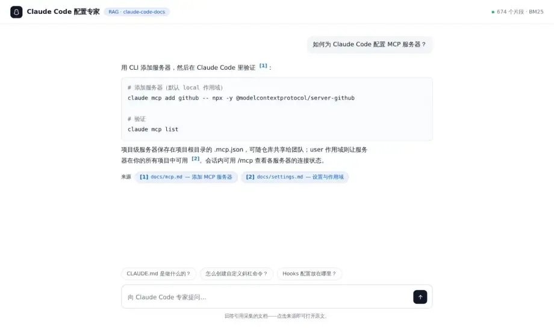
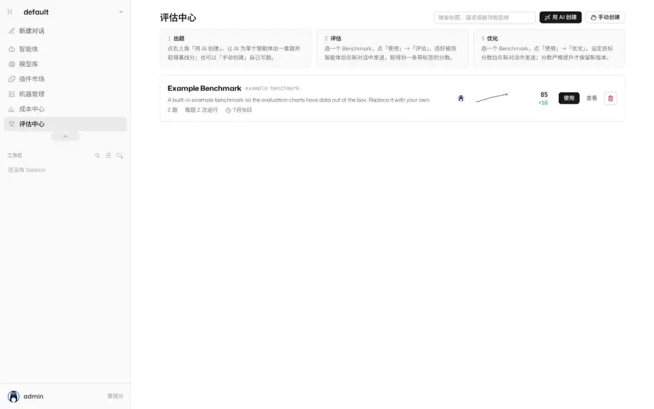
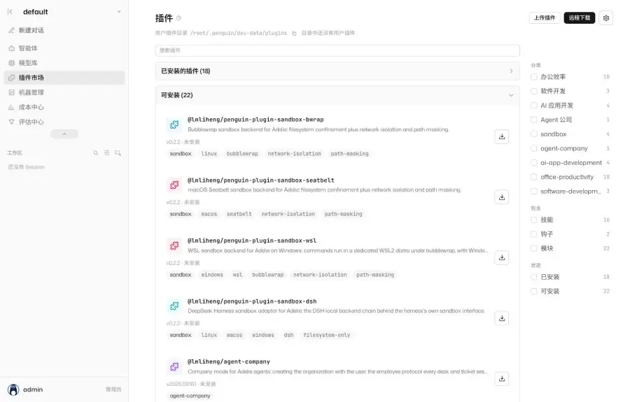

<p align="center">
  <picture>
    <source media="(prefers-color-scheme: dark)" srcset="assets/readme/adelie-icon-dark.gif" />
    
  </picture>
</p>

<h1 align="center">Adelie</h1>

<p align="center"><strong>本地优先的多智能体应用开发平台，构建在 PenguinHarness 之上</strong></p>

<p align="center">
  <a href="LICENSE"></a>
  = 24" />
  <a href="https://github.com/Prism-Shadow/penguin-harness"></a>
</p>

> [!IMPORTANT]
> **Adelie 是 [PenguinHarness](https://github.com/Prism-Shadow/penguin-harness) 的 fork。**
> 这棵代码树、引擎、Web 前端与协议都来自 PenguinHarness（Apache-2.0）；Adelie 是长在它上面的
> 产品线 —— 自己的品牌与界面、自己的数据根与端口、自己的发布链路。
>
> - 来源、许可证义务、我们改了什么：[`FORK.md`](docs/FORK.md)
> - 改到哪一步了：[`FORK-PROGRESS.md`](docs/FORK-PROGRESS.md)
> - 上游自己的渠道（仓库、官网、文档、博客、社区、Discord、X、微信、Product Hunt）是**上游的**，
>   不是 Adelie 的：<https://github.com/Prism-Shadow/penguin-harness> · <https://penguin.ooo/>
> - PenguinHarness / PrismShadow 的名字与商标属于上游。Adelie 不拿它们当自己的名号、图标或域名。

<p align="center"><a href="README.en.md">English</a> | 简体中文</p>

<p align="center">
  <a href="assets/promo/adelie-promo.mp4">
    
  </a>
</p>

<p align="center"><sub>57 秒宣传片 · 1920×1080 · 点封面播放</sub></p>

## 为什么选择 Adelie

> 使用 LangChain，以 1 倍速度人工构建 Agent；<br />使用 Adelie，以 100 倍速度用 Agent 构建 Agent。

Adelie 运行在你的电脑或服务器上，自动串联 Agent 应用的创建、评测、优化与部署。三个递进的理由定义了这个平台：

### 1. 🏆 以几十分之一的成本，跑出优异的效果

刻意精简的工具集配合干净的底层接口：更少的工具调用、更少的 Token，对 DeepSeek 等开放模型深度适配。各自搭配常用模型、同一批任务，正面对比：

<p align="center">
  <picture>
    <source media="(prefers-color-scheme: dark)" srcset="assets/readme/benchmark-dark.svg" />
    
  </picture>
</p>

**数据分析准确率最高——成本只有 Claude Code 的 1/70。**

### 2. ⚡ 一句话生成可运行的 Agent 应用

用一句话描述需求，Adelie 自动构建完整的 Agent 应用——脚手架、代码、运行说明，一步到位：

```text
收集 https://github.com/ericbuess/claude-code-docs 的文档，做一个化身 Claude Code 配置专家、回答带来源引用的 RAG 问答应用。
```

这是做出来的成品——一个文档专家：检索增强、引用可点击直达原文、内置示例问题：

<p align="center">
  <picture>
    <source media="(prefers-color-scheme: dark)" srcset="assets/readme/rag-app-zh-dark.webp" />
    
  </picture>
</p>

**而生成整个 RAG 应用，仅消耗了 0.2 元（$0.02）的 token——使用 DeepSeek V4 Pro 模型。**

### 3. 🧬 原生 Agent 自进化引擎

借助 Adelie 技能库，Agent 自己评估、自己优化：跑 Benchmark、找失分点、发布 N+1 版——每轮之前自动快照，每个请求都可在轨迹观测中回放。

<p align="center">
  <picture>
    <source media="(prefers-color-scheme: dark)" srcset="assets/readme/evaluation-center-zh-dark.webp" />
    
  </picture>
</p>

*这份 README 里的图：基准对比图出自上游 PenguinHarness 作者对该代码库的实测——Adelie 用的就是同一套引擎与界面，所以它说的就是这份 fork 的能力；其余截图都是 Adelie 自己的界面，在本机实例上截的。*

## 内置插件库

开箱内置四类插件（文档在这个仓库的 [`packages/docs`](packages/docs) 里）——Skill，以及驱动目标模式与持续学习的会话钩子；Agent 也能编写并优化自己的 Skill：

| 分类        | 插件                                                                            |
| ----------- | ------------------------------------------------------------------------------- |
| 办公效率    | `data-analysis`、`use-firecrawl`、`use-offerdao`、`browser-automation`、`use-bento-slides`、`use-lieflat-charts`、`use-wps-office`、`use-seedance`、`use-seedream`、`humanizer`、`goal`、`continual-learning`、`csu-mail`、`lesson-video`、`requirements-box` |
| 软件开发    | `software-development`、`use-claude-code`、`wechat-miniprogram`、`gpu-model-serving`、`web-vscode`            |
| AI 应用开发 | `agent-development`、`model-development`、`skill-porting`、`agent-tuning`       |
| Agent 公司  | `agent-company`                                                                 |

**插件市场**页把这套插件全列出来：每条读的是插件包自己的 README、版本、许可证与关键词，一键安装。

<p align="center">
  <picture>
    <source media="(prefers-color-scheme: dark)" srcset="assets/readme/plugin-market-zh-dark.webp" />
    
  </picture>
</p>

桌面应用的侧边停靠栏里还内置了一个浏览器。Agent 通过 `penguin browser` 和 `browser-automation` 插件驱动它：读取页面、点击和输入，并提取亚马逊订单这样的数据，登录用的是从你自己的浏览器导入的账号。

## 支持的模型

| 模型             | 可用供应商                                                                                       |
| ---------------- | ------------------------------------------------------------------------------------------------ |
| DeepSeek V4      | DeepSeek, OpenRouter, Fireworks AI, SiliconFlow, TokenDance, Qwen Token Plan, Qwen Pay-As-You-Go |
| Kimi K3          | Moonshot AI, OpenRouter, Fireworks AI, TokenDance, Qwen Pay-As-You-Go                            |
| GLM 5.3          | Z.AI, OpenRouter, TokenDance                                                                     |
| Hunyuan 3        | OpenRouter                                                                                       |
| Qwen 3.8 Max     | Qwen Token Plan, Qwen Pay-As-You-Go, OpenRouter, TokenDance                                      |
| GPT 5.6          | OpenAI, OpenRouter                                                                               |
| Gemini 3.7 Flash | Google Gemini, OpenRouter                                                                        |
| Claude 5         | Anthropic, OpenRouter                                                                            |
| Inkling          | OpenRouter, Fireworks AI                                                                         |

上表每个系列只列最新一代，完整预置清单请在应用的**模型**页查看；只要是 OpenAI 协议的端点都可以接入：选择预置，或用自定义端点连接 1000+ 在线与本地模型。

## 系统需求

| 需求项                   | 支持情况                                                    |
| ------------------------ | ----------------------------------------------------------- |
| 操作系统（桌面端）       | Windows 10+（x64）、Linux（x64）                            |
| 操作系统（命令行 / Web） | Windows、Linux、macOS（arm64 / x64），走 npm 安装           |
| 运行时                   | 桌面安装包无需另外装，自带 Node；走 npm 装命令行才要 Node >= 24 |
| 模型                     | 至少一个模型供应商的 API Key                                |

## 安装

所有产物都在 [GitHub Releases](https://github.com/lmliheng/Adelie/releases)：一次发布是一个整体版本，
桌面端、命令行、服务端与 Web 前端同号。

### 桌面应用

| 平台            | 产物                                                                       |
| --------------- | -------------------------------------------------------------------------- |
| Windows 10+ x64 | `adelie-desktop-win32-x64.exe` —— NSIS 安装器，按用户安装                  |
| Linux x64       | `adelie-desktop-linux-x86_64.AppImage` 或 `adelie-desktop-linux-amd64.deb` |
| macOS           | 不随发布提供 —— 见下                                                       |

macOS 的打包链路是通的：`electron-builder` 配着 dmg / zip 目标，CI 每次也真的构建一份，但
**发布不带它**——把它发出去需要一张 Apple 开发者证书做签名与公证，而未签名、未公证的包会被
Gatekeeper 拦下，也拿不到更新（发布里同样没有 `latest-mac.yml`）。macOS 上目前请用命令行或
Web 端：`npm install -g @adelie/cli`（需要机器上有 Node >= 24），装好之后 `penguin web` 打开的
就是同一个界面。

Windows 安装包**还没有代码签名**，SmartScreen 会提示一次（「更多信息 → 仍要运行」）。应用自己会
检查更新，读的就是这个仓库的 GitHub Releases —— 升级走应用里的「检查更新」就行。

首次启动会有一次登录：打开服务端打印的「首次登录链接」，认领内置的 `admin` 账号并设置密码（没有
可输入的初始密码）。模型在应用内的**模型库**页配置 —— 新实例要先配一个 API key 才能跑任务。

## 参与开发

```bash
pnpm install && pnpm build   # 先构建：core 的导出指向 dist/
pnpm dev                     # 后端 + Web 前端一起起（日志带前缀，依赖只构建一次）
```

完整的工作区指南见 [CONTRIBUTING.zh.md](.github/CONTRIBUTING.zh.md)（那份文件是上游的，大体仍准确）：
开发命令、质量门禁、仓库结构、变更日志规则。上游的官网站点 `packages/landing` 已在本 fork 中删除。

本 fork 自己的文档收在 [`docs/`](docs/README.md) —— fork 的由来、进度台账与各版本的发布正文 ——
仓库根只留约定俗成的那几份。

## 上游路线图

这里是上游项目的路线图，留作了解这个基座往哪走。Adelie 自己的计划在
[`FORK-PROGRESS.md`](docs/FORK-PROGRESS.md)。

- [ ] Benchmark 套件正式发布
- [x] 桌面端应用
- [x] Windows 系统支持
- [ ] Agent 公司与模板
- [ ] 公司级自进化能力
- [ ] 集成 OpenShell（带权限管控的 shell）
- 更多规划，敬请期待……

## 引用

如果你用到了这套代码，请引用它的上游项目（Adelie 是它的 fork）：

```bibtex
@software{penguinharness2026,
  author  = {{PrismShadow Team}},
  title   = {PenguinHarness: Efficient Self-Improving Harness for Everyone},
  year    = {2026},
  url     = {https://github.com/Prism-Shadow/penguin-harness},
  license = {Apache-2.0}
}
```

## 致谢

本项目受益于：

- [MinGit](https://github.com/git-for-windows/git)：Windows 版内置的 POSIX shell 与 Git
- [GenericAgent](https://github.com/lsdefine/genericagent)：内置浏览器自动化

许可证详见 [THIRD-PARTY-NOTICES.md](THIRD-PARTY-NOTICES.md)。

## 协议

[Apache-2.0](LICENSE) © 2026 Prism Shadow —— 这是上游的版权。Adelie 是它的 fork，
以同一协议发布；见 [`FORK.md`](docs/FORK.md)。

上游 PenguinHarness 由 [LlamaFactory](https://github.com/hiyouga/LlamaFactory) 作者 [Yaowei Zheng](https://github.com/hiyouga)、[PrismShadow AI Team](https://github.com/Prism-Shadow) 与 [Fable 5](https://www.anthropic.com/news/claude-fable-5-mythos-5) 共同用 ❤️ 构建。Adelie 是这份工作的 fork。
